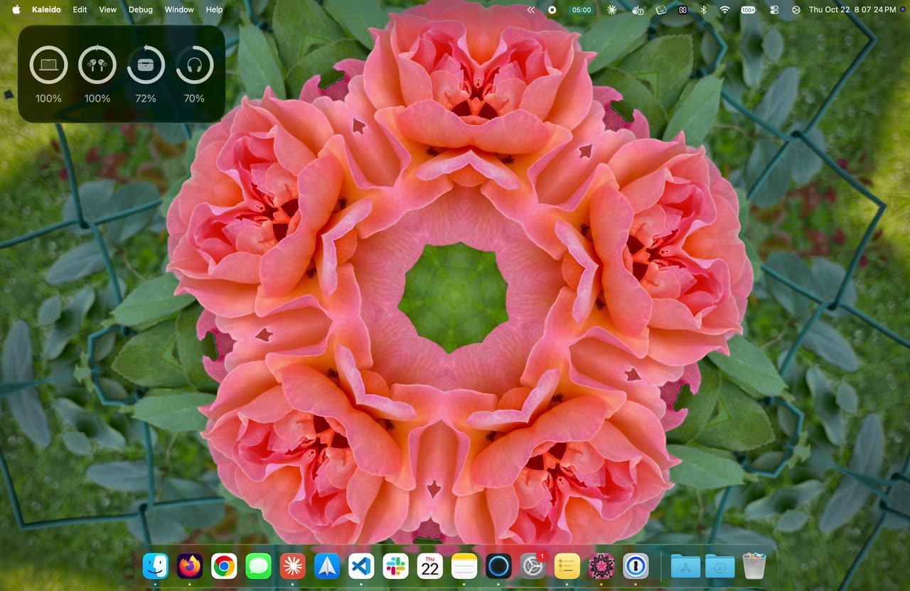
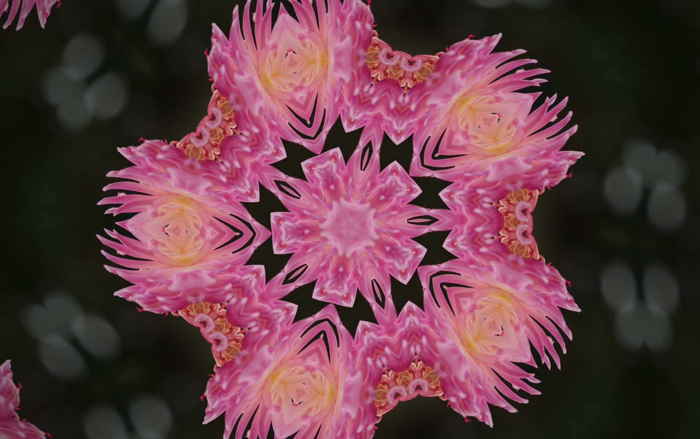
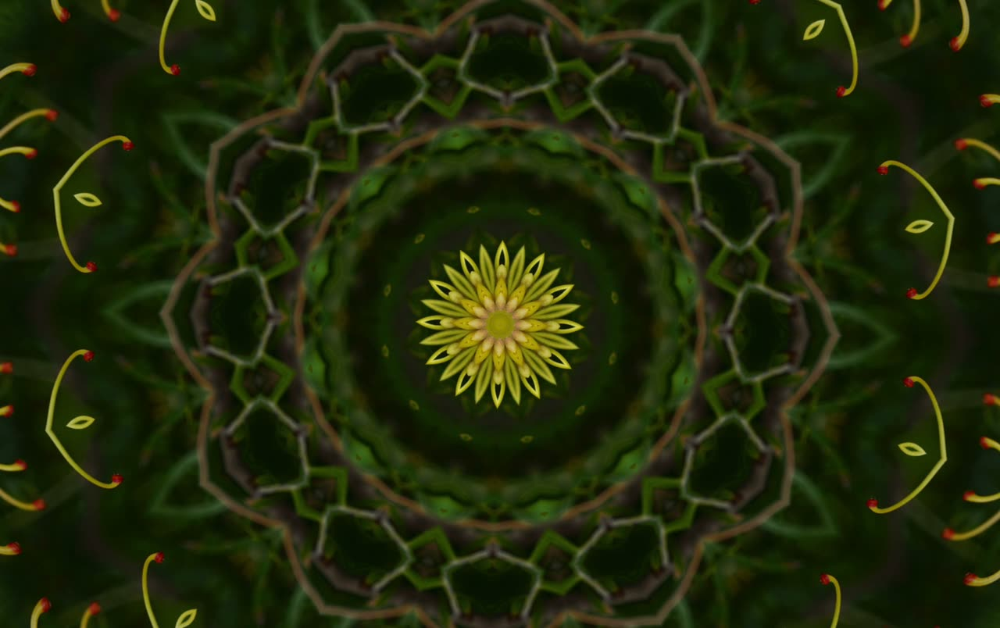
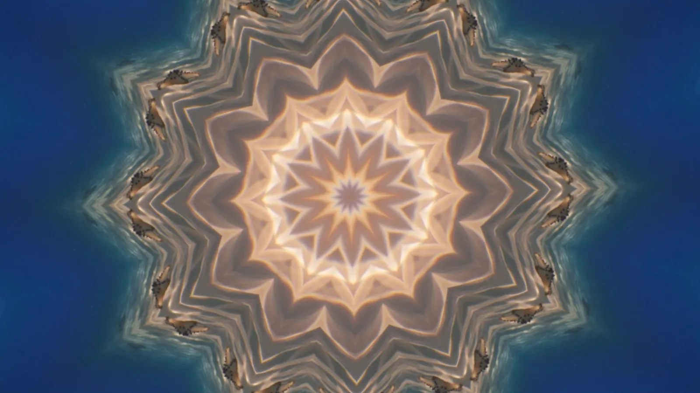
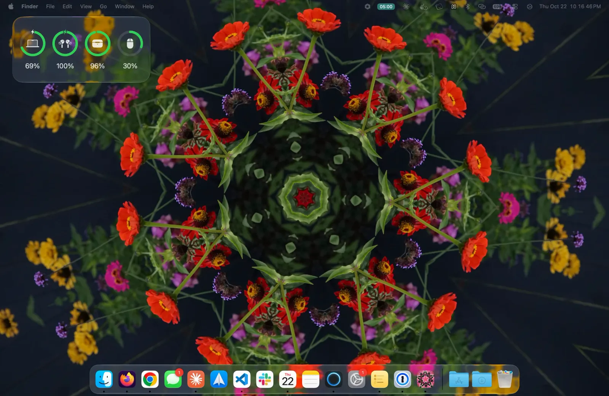
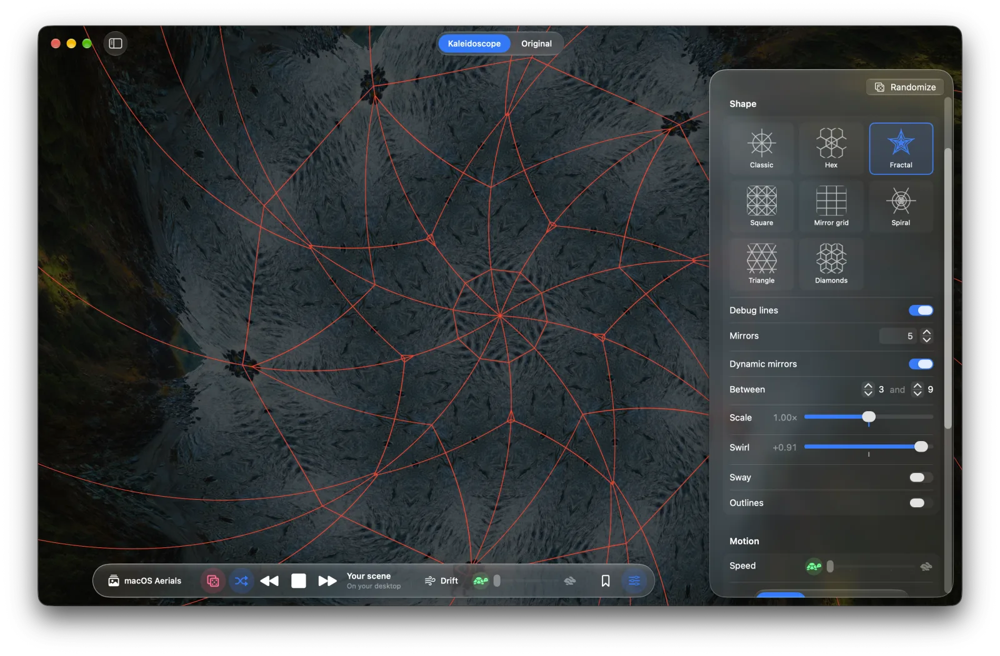
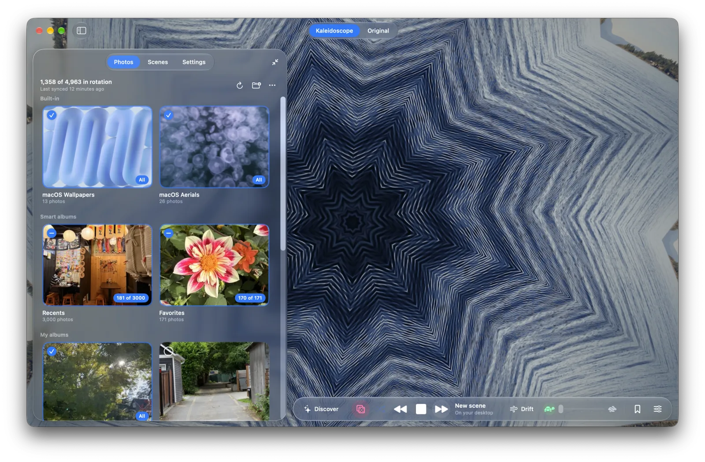
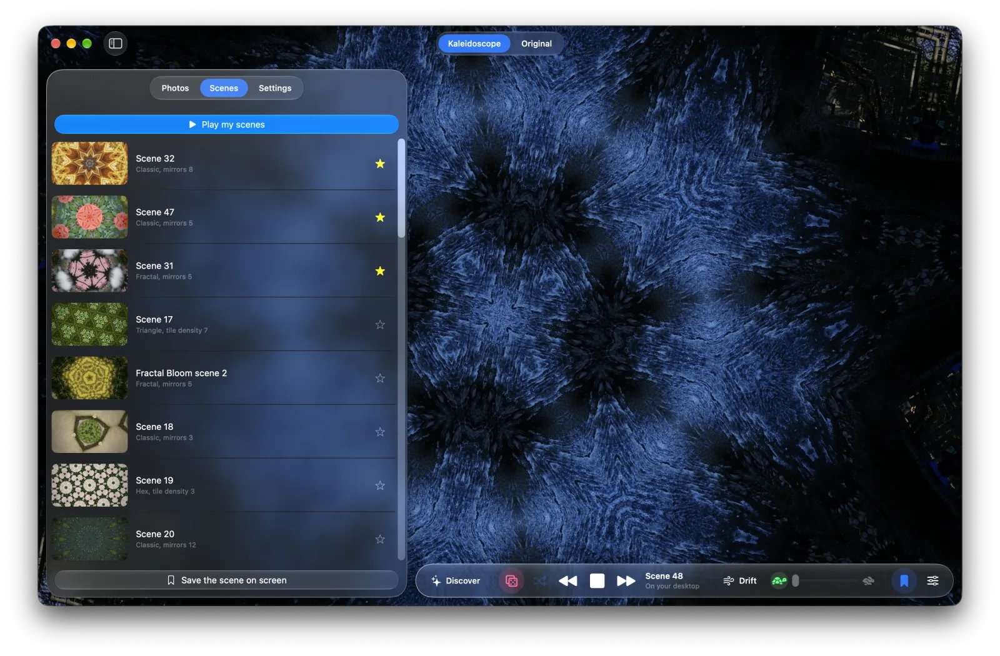

# Kaleido

<p align="center"></p>

<h2 align="center"><em>Reimagine</em> your photos</h2>

<p align="center">For macOS 26 · Native Swift and Metal · No accounts, no cloud</p>

Kaleido turns your photos, and macOS's own slow-motion aerial films, into slowly turning kaleidoscopes that play
on your Mac's desktop. It never touches your wallpaper settings: press Stop or quit, and your normal wallpaper is
simply back. The landing page lives in [`site/`](site/).

## Bring life to your photos

| Original | Kaleido |
| --- | --- |
|  |  |
|  |  |

## And macOS's aerial films

The slow-motion aerials behind macOS's own screen savers play too, as moving kaleidoscopes.

| Original | Kaleido |
| --- | --- |
|  |  |
|  |  |

## Features

**Your desktop, alive.** Press Play and the kaleidoscope fills your desktop, slowly turning behind your icons and
windows. Press Stop and your usual wallpaper is back.



**A new toy to play with.** Flip through scenes, click and drag, flick it to watch it glide.

**Shape every pattern.** Have fun playing with the pattern editor. Many knobs and dials to tune. Or keep things
random :)



**Pick what plays.** Browse and choose your photos, built-in sets and smart albums to play.



**Keep the ones you love.** Bookmark a scene to save the photo with its pattern. Star your favorites, then play
your scenes as a playlist.



## Install

Requires macOS 26 or later (it uses Liquid Glass) and Xcode (or the Swift toolchain).

```sh
cd ~/Projects/kaleido
./scripts/build.sh            # builds build/Kaleido.app
./scripts/install.sh          # builds and installs to /Applications (quits and relaunches a running copy)
open build/Kaleido.app
```

Run the tests with `swift test`.
